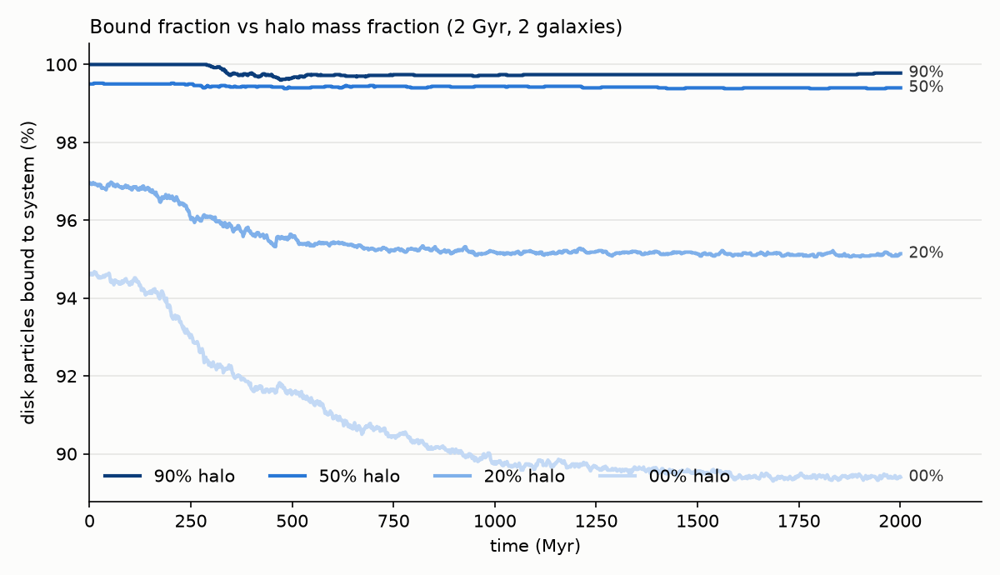

# Galaxy Sim

A 2D gravitational simulation of galaxy collisions, written in C++20. It asks one question: **how do the starting conditions of an encounter change the fraction of stars a galaxy loses?**

Two mass models are available from the start menu:

- **Centralized (Kepler):** each galaxy is a single central mass orbited by massless test stars. It is fast and good for intuition, but the star-loss numbers are artifacts of the model, because there is no halo and stars have no gravity.
- **Distributed (Barnes-Hut N-body):** each galaxy is a central black hole, a self-gravitating disk and a live dark-matter halo. Every particle pulls on every other through a quadtree with O(N log N) cost.

## Physics

| Piece | Choice |
|---|---|
| Units | light-years, years, solar masses (G = 1.5608e-13 ly³ / (Msun yr²)) |
| Integrator | kick-drift-kick leapfrog: second order, symplectic, time-reversible (measured convergence ratio 4.00) |
| Gravity | Plummer softening; Barnes-Hut monopole tree with opening angle θ = 0.5, parallelized with OpenMP |
| Timestep | `dt = η·sqrt(ε / max|a|)` with η = 0.05, a pericentre cap for two galaxies, and a ratchet that halves dt if the peak acceleration grows 4x |
| Galaxy model | 1% black hole, 9% disk, 90% halo by mass (adjustable); halo velocities from the Jeans equation; disk speeds from the measured in-plane force |
| Start-up | each galaxy is pre-relaxed alone (800 Myr by default) to remove the breathing of a freshly sampled galaxy |
| Metric | a disk particle is bound if ½v² + φ < 0 in the system's centre-of-mass frame |

## Halo-fraction sweep

The same two-galaxy encounter was run four times for 2 Gyr, changing only the share of the galaxy mass in dark matter.



| Halo | Bound at t=0 | Bound at 2 Gyr | Lost during run | Energy drift |
|---|---|---|---|---|
| 90% | 100.00% | 99.78% | 0.22 pt | 3.1e-3 |
| 50% | 99.50% | 99.40% | 0.10 pt | 1.6e-3 |
| 20% | 96.96% | 95.14% | 1.82 pt | 2.1e-3 |
| 0% | 94.62% | 89.40% | 5.22 pt | 2.2e-3 |

Galaxies with less dark matter lose far more stars. Limitations: this is one seed and one geometry, the sim is 2D, the halo fraction is chosen rather than fit to data, and low-halo runs start with some particles already unbound for reasons I haven't verified yet. It is a model comparison, not evidence for dark matter over modified gravity.

## Building

Requires CMake 3.20+, a C++20 compiler (tested with MinGW g++ and Ninja on Windows) and Git. SDL2 and Dear ImGui are downloaded automatically during configuration.

```sh
cmake -S . -B build -G Ninja
cmake --build build
ctest --test-dir build      # sim, N-body, camera and logger tests
```

Use `-DGALAXY_BUILD_APP=OFF` to build only the simulation library, the batch runner and the tests (no graphics dependencies), or `-DGALAXY_USE_OPENMP=OFF` to run single-threaded.

## Running

### Interactive app

```sh
./build/galaxy_app                     # opens the setup panel
./build/galaxy_app --two --distributed --dm
```

Any argument skips the setup panel and starts immediately: `--two`, `--distributed`, `--stars N`, `--vel km/s`, `--speed Myr/s`, `--halo-frac f`, `--relax Myr` (0 = off), `--dm` (draw dark matter in blue), `--log` (write a CSV every 1 Myr to `logs/`).

Controls: **Space** pauses, **R** resets, **Esc** quits.

### Headless batch runner

```sh
./build/galaxy_batch --distributed --stars 2500 --halo-frac 0.2 --gyr 2 --out logs/run.csv
```

The main options are `--impact-frac f` / `--impact ly`, `--vel`, `--gyr`, `--one`, `--theta`, `--bh-frac`, `--halo-frac`, `--halo-ratio`, `--disp`, `--hole f` (central hole radius, which allows larger timesteps), `--relax`, `--profile exp|uniform` and `--snapshot file.csv`. Each CSV row holds the time, the separation of the two centres and the bound percentages.

### Plots

```sh
python -m venv tools/.venv
tools/.venv/Scripts/pip install -r tools/requirements.txt    # bin/ on macOS/Linux
tools/.venv/Scripts/python tools/plot_log.py logs/run.csv
tools/.venv/Scripts/python tools/plot_halo_sweep.py
```

## Layout

```
src/sim/      physics: integrators, quadtree, galaxy models, scenarios (no graphics)
src/render/   OpenGL point renderer and camera
src/app/      SDL2 + ImGui app, setup panel, CSV logger, batch runner
tests/        dependency-free test executables
tools/        Python plotting scripts
docs/         diagrams and notes
```

## Known limitations

- The sim is 2D, so the potentials and stability (Toomre Q) are not the 3D ones.
- The halo is a 2D Gaussian velocity model, not an exact equilibrium, which is why pre-relaxation is needed. The relaxed disk ends up puffier.
- Start-up takes about a minute per 20k-particle galaxy, and Reset redoes the relaxation.
- Tree energy error grows roughly as θ², and the timestep ratchet only shrinks.

## Built with AI assistance

The code was written with Claude Code from my specifications. I made the design decisions, reviewed the code and the results, and drove the debugging (for example the disk clumping, the energy-drift checks and the breathing at start-up). I can explain how each part works. I plan to hand-write my own Barnes-Hut tree and integrator later, using this project's scaffolding and tests.
